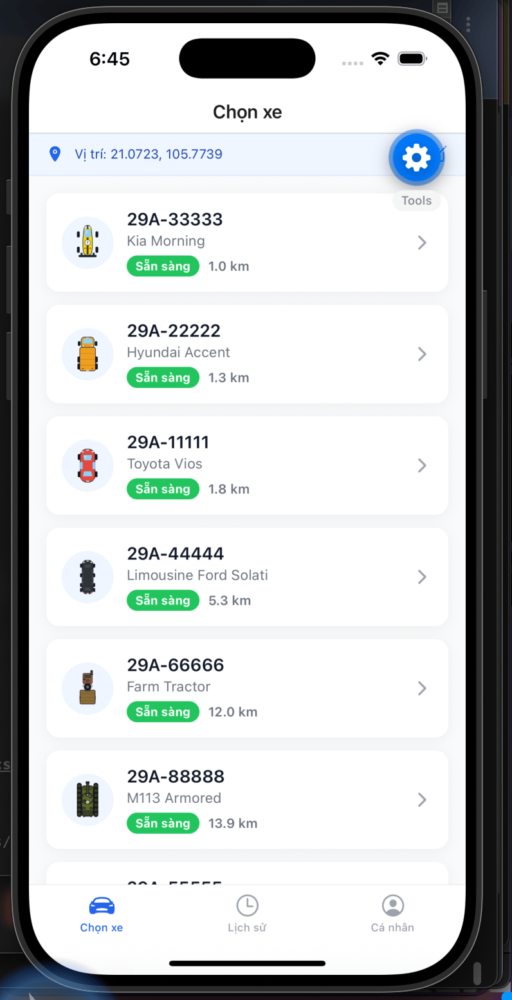
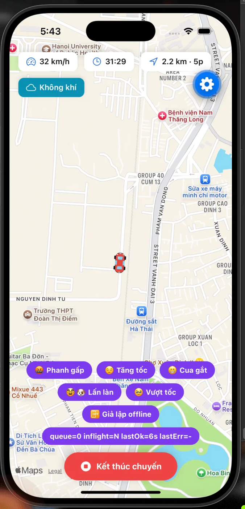
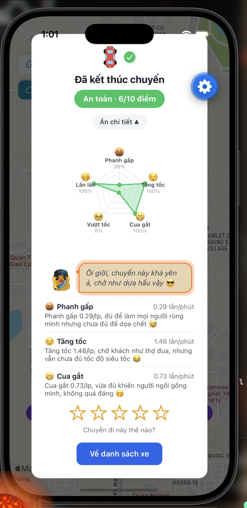
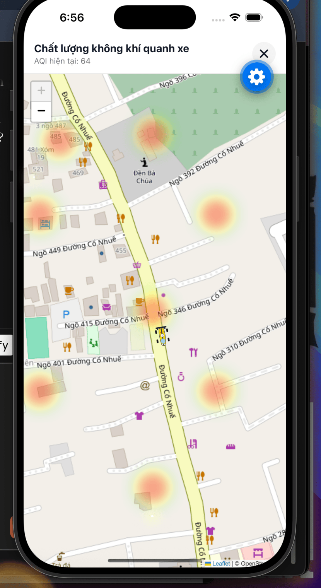
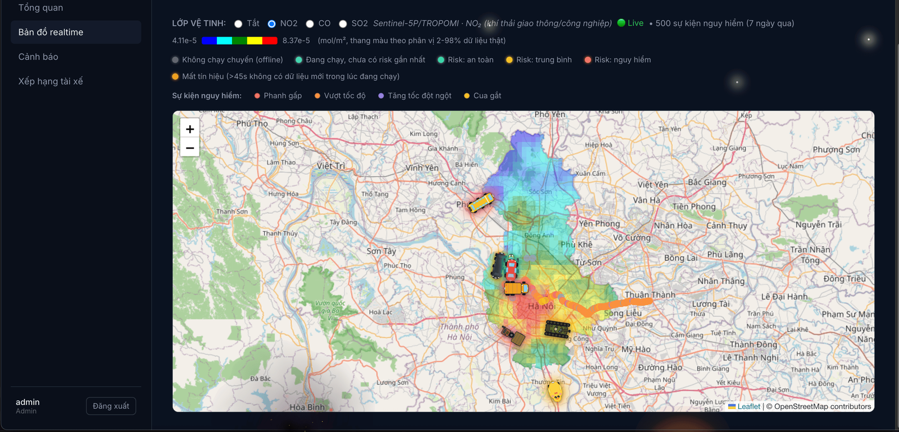
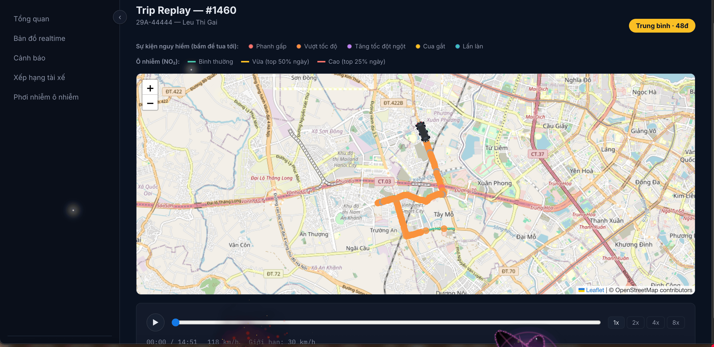
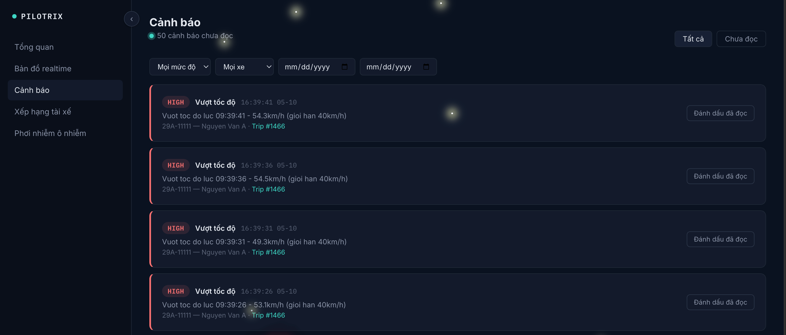
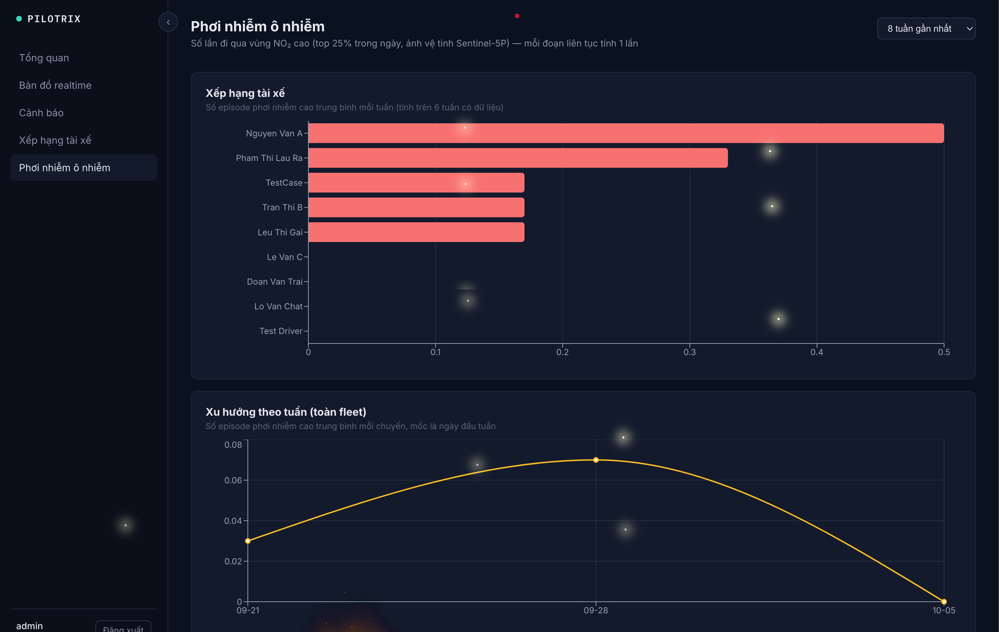
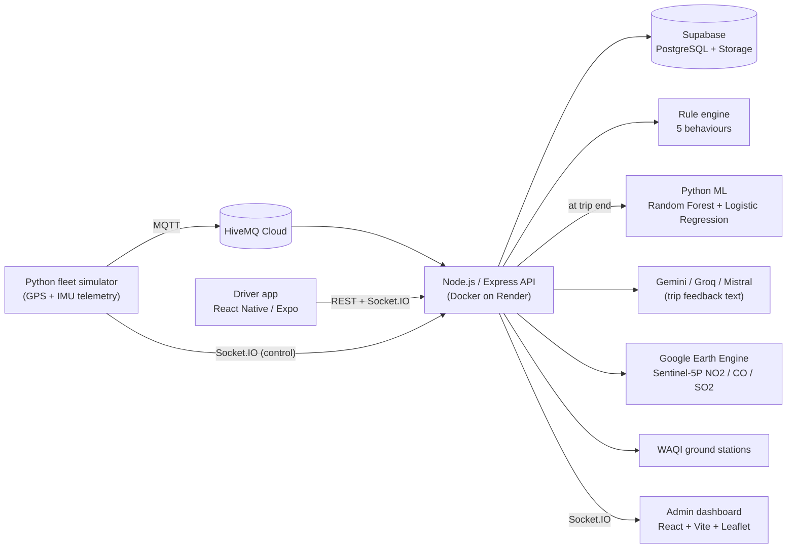

# Pilotrix

**Fleet management and driver-behaviour risk scoring, built end to end: IoT telemetry → rule engine → machine learning → GIS/satellite analytics → mobile and web apps.**

Pilotrix is my undergraduate thesis project (Geoinformatics). A driver books a vehicle in a mobile app, the trip streams GPS and motion telemetry, a rule engine flags dangerous manoeuvres in real time, and a machine-learning model scores the whole trip when it ends. Fleet admins watch everything live on a web dashboard that overlays Sentinel-5P satellite air-quality data on the map.

> **Live deployment:** the admin dashboard is at <https://pilotrixxx-dashboard.onrender.com> and the API at <https://pilotrixxx.onrender.com>. Both run on free tiers, so the **first request after idle can take up to a minute** while the API wakes up. The admin login is private; see the screenshots below.
>
> **Demo video:** <https://youtu.be/eUKoAGENXjo>.

## Screenshots

<table>
  <tr>
    <td align="center"><br><sub>Choose a nearby vehicle</sub></td>
    <td align="center"><br><sub>Live trip with behaviour triggers (dev mode)</sub></td>
    <td align="center"><br><sub>Post-trip score and behaviour radar</sub></td>
    <td align="center"><br><sub>IDW air-quality heatmap around the vehicle</sub></td>
  </tr>
</table>

<p align="center">
  <br>
  <sub>Admin dashboard: live fleet map with the Sentinel-5P NO₂ layer</sub>
</p>
<p align="center">
  <br>
  <sub>Trip replay: step through a finished trip with driving events and NO₂ exposure segments drawn on the route</sub><br><br>
  <br>
  <sub>Alerts: real-time speeding and risk alerts, filterable by severity, vehicle and date</sub><br><br>
  <br>
  <sub>NO₂ exposure: driver ranking by high-pollution episodes over the last 8 weeks, with a weekly trend</sub>
</p>

## Architecture



There are two independent telemetry paths: a Python fleet simulator publishing over MQTT (background fleet), and the real driver app sending telemetry over REST. Fixes to one path do not automatically apply to the other.

## Features

**Driver app (React Native / Expo, TypeScript)**

- Email + OTP registration, JWT login, profile with avatar upload (Supabase Storage).
- Vehicle booking: nearby vehicles, a simulated vehicle that drives to the pickup point (OSRM routes) with ETA and timeouts.
- Trip telemetry every 8 s, live overspeed warning, and a **persistent offline queue**: if the network drops mid-trip, points are stored on the device and replayed in order with their original timestamps; the server de-duplicates and does not move the live marker backwards.
- Post-trip score (0–10), a five-axis behaviour radar (hard braking, rapid acceleration, sharp turns, overspeed, lane drift) and a short AI-generated comment with static fallbacks.

**Backend (Node.js / Express, Socket.IO, PostgreSQL)**

- MQTT ingestion and a REST telemetry endpoint feeding one pipeline.
- **Rule engine** that evaluates every telemetry row independently and writes events; only `high`-severity events become alerts.
- Trip summary generation, ML risk scoring at trip end, and AQI exposure computation per trip.
- Role-separated JWT auth (admin vs driver).

**Admin dashboard (React, Vite, Leaflet)**

- Live fleet map, alerts page with filters and pagination, driver ranking, and trip replay (event markers plus the route coloured by NO₂ exposure).
- Real-time toasts and browser notifications for high-severity alerts and dangerous trips.
- Satellite layers (NO₂, CO, SO₂) from Sentinel-5P/TROPOMI via Google Earth Engine, and an air-pollution exposure page (driver ranking and weekly trend).

## How risk is scored

**1. Rule engine (per telemetry row).** Thresholds were chosen against the simulator's scenarios.

| Behaviour          | Signal                 | Medium | High   |
| ------------------ | ---------------------- | ------ | ------ |
| Hard braking       | brake intensity        | ≥ 0.60 | ≥ 0.75 |
| Rapid acceleration | longitudinal accel (g) | ≥ 0.25 | ≥ 0.40 |
| Sharp turn         | lateral accel (g)      | ≥ 0.30 | ≥ 0.50 |
| Overspeed          | speed / speed limit    | ≥ 1.05 | ≥ 1.20 |
| Lane drift         | heading offset (°)     | ≥ 8    | ≥ 15   |

Invalid GPS fixes are recorded as events and suppress the other rules for that row.

**2. Machine learning (per trip).** At trip end the backend builds a 13-feature summary (distance, speeds, per-minute rates of the five behaviours, overspeed ratio, GPS-invalid count, …) and classifies the trip as `safe`, `moderate` or `dangerous`. Random Forest is the primary model; Logistic Regression is the baseline.

| 5-fold stratified CV (900 trips) | Accuracy       | F1-macro       |
| -------------------------------- | -------------- | -------------- |
| Logistic Regression              | 95.11% ± 0.96% | 95.12% ± 0.99% |
| Random Forest                    | 94.78% ± 1.14% | 94.78% ± 1.14% |

The two models are statistically indistinguishable on this data. Out-of-fold confusion matrices show no `safe` ↔ `dangerous` confusions; all errors are between adjacent levels. **Caveat:** the training set is _synthetic_ (900 trips from three scenarios with overlapping distributions and injected noise), so these numbers measure how well the model separates simulated scenarios, not accuracy on real drivers. Reproduce with `python ml/train.py`.

## Engineering and security notes

- JWT roles are enforced in middleware (`admin` and `driver` tokens are not interchangeable). The driver id always comes from the token, never from the request body, and trip endpoints check ownership.
- OTP flow: 60 s cooldown (row-locked to avoid races), 2 sends per 24 h, 5 attempts per code, and generic responses to prevent user enumeration.
- Secrets live in environment variables only. The Supabase service-role key stays on the server. The simulator's control channel is protected by a shared secret.
- Offline queue details: single-flight per trip, hard 15 s deadline per request (axios timeouts are unreliable on React Native), bounded at 1000 points, client-clock-skew compensation on the server.
- Satellite data is cached per day on a 0.01° grid and fetched lazily, so no cron job is needed.

## Tech stack

| Layer          | Technology                                                                |
| -------------- | ------------------------------------------------------------------------- |
| Mobile         | React Native, Expo (Expo Router), TypeScript, SecureStore, AsyncStorage   |
| Web dashboard  | React, Vite, Leaflet, Socket.IO client                                    |
| Backend        | Node.js, Express, Socket.IO, MQTT, `pg`, JWT                              |
| Data           | Supabase PostgreSQL and Storage                                           |
| IoT simulation | Python, MQTT (HiveMQ Cloud), OSRM, GPX route replay                       |
| ML             | Python, scikit-learn (Random Forest, Logistic Regression)                 |
| GIS            | Google Earth Engine (Sentinel-5P), WAQI, IDW interpolation, OpenStreetMap |
| Email          | Brevo HTTP API                                                            |
| Deployment     | Render (Docker for the API, static site for the dashboard)                |

## Repository layout

```
.
├── backend/      Express API, MQTT consumer, rule engine, services
├── frontend/     Admin dashboard (React + Vite)
├── mobile/       Driver app (Expo / React Native)
├── ml/           Synthetic data generator, training, prediction
├── simulator/    Fleet simulator, GEE export/fetch scripts, demo route
├── docs/         Database schema, demo seed data, screenshots
├── Dockerfile    Backend image (Node + Python for ML and GEE)
└── mqtt_payload_schema.md
```

## Getting started

Requirements: Node.js and pnpm, Python 3, a PostgreSQL database (Supabase works), an MQTT broker (HiveMQ Cloud free tier works).

1. **Environment.** Copy `backend/.env.example` to `backend/.env` and fill in the values below. Never commit `.env` or any service-account JSON.

   | Variable                                                                     | Purpose                                                                            |
   | ---------------------------------------------------------------------------- | ---------------------------------------------------------------------------------- |
   | `PORT`                                                                       | API port (default 3000)                                                            |
   | `DATABASE_URL`                                                               | PostgreSQL connection string (Supabase pooler)                                     |
   | `MQTT_HOST`, `MQTT_PORT`, `MQTT_USERNAME`, `MQTT_PASSWORD`, `MQTT_CLIENT_ID` | MQTT broker                                                                        |
   | `JWT_SECRET`                                                                 | Signs admin and driver tokens                                                      |
   | `BREVO_API_KEY`, `BREVO_SENDER_EMAIL`                                        | OTP emails                                                                         |
   | `FLEET_CONTROL_SECRET`                                                       | Shared secret for the simulator's control channel                                  |
   | `WAQI_TOKEN`                                                                 | Ground air-quality stations                                                        |
   | `SUPABASE_URL`, `SUPABASE_SERVICE_ROLE_KEY`                                  | Avatar storage                                                                     |
   | `GEMINI_API_KEY`, `GROQ_API_KEY`, `MISTRAL_API_KEY`                          | Optional: AI trip comments (falls back to static text)                             |
   | `GEE_SERVICE_ACCOUNT_KEY`                                                    | Optional: JSON of a Google Earth Engine service account, for live satellite layers |

2. **Database.** Create a PostgreSQL database (Supabase works), then load the schema and the optional fake demo vehicles:
   ```bash
   psql "<connection string>" -f docs/schema.sql
   psql "<connection string>" -f docs/seed.sql
   ```
   For verified TLS to Supabase, put the project's CA certificate at `backend/src/certs/supabase-ca.crt`. Without it the backend still starts, but falls back to unverified TLS and logs a warning.
3. **Backend.** `cd backend && pnpm install && pnpm dev`. To log in to the dashboard you need one admin row. Generate a password hash with `node scripts/hash-password.js "YourPassword"` (run from `backend/`) and insert it:
   ```sql
   INSERT INTO admins (username, password_hash, full_name)
   VALUES ('admin', '<hash printed by the script>', 'Admin');
   ```
4. **Dashboard.** In `frontend/.env` set `VITE_API_URL=http://localhost:3000` and `VITE_SOCKET_URL=http://localhost:3000`, then `cd frontend && pnpm install && pnpm dev`.
5. **ML models.** `pip install -r ml/requirements.txt && python ml/generate_synthetic_data.py && python ml/train.py` (the Docker build does this on deploy).
6. **Fleet simulator.** Create `simulator/.env` with `BACKEND_URL`, `DATABASE_URL` and `FLEET_CONTROL_SECRET` (same value as the backend), then `cd simulator && pip install -r requirements.txt && python run_fleet.py`
7. **Mobile app.** `cd mobile && pnpm install && pnpm exec expo start -c`. The API URL is a `BASE_URL` constant in `mobile/src/api/client.ts` and `mobile/src/api/socket.ts` (both default to the hosted API); change both to point at your own backend.

## Known limitations

- The ML model is trained on synthetic data and has not been validated on real driving data.
- The offline queue was tested with an in-app offline switch on the iOS Simulator, not yet on a physical phone in airplane mode.
- A single admin account; there is no role-based access control beyond admin vs driver.
- The deployment uses free tiers (cold starts, and idle database projects can be paused by the provider).
- Server-side clock-skew compensation for the offline queue has only been tested with mocked timestamps, not on a phone with a wrong clock.

## Roadmap

QR check-in at pickup, batch upload endpoint for very large offline queues, validation on real telematics data.

## License

Copyright © 2026 Duc Toan. All rights reserved. Source is public for portfolio review.
